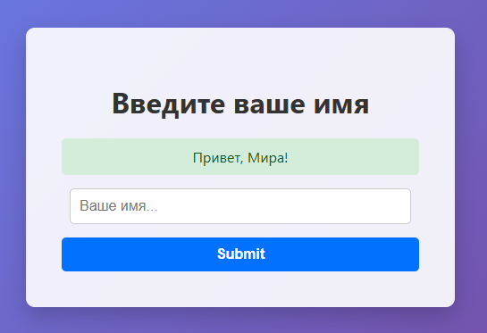
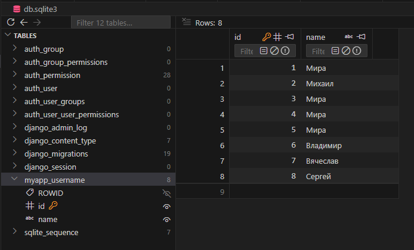

# Django Hello App (Приветствие пользователей)

## Описание программы
Простое веб-приложение на фреймворке Django, которое позволяет пользователям вводить свои имена. 
Программа сохраняет введенное имя в базу данных, а затем отображает его на главной странице в виде персонализированного приветствия. Также реализована защита формы от CSRF-атак и валидация на пустое поле ввода.

## Как запустить
Для запуска проекта вам понадобится установленный Python (версия 3.8 или выше).

1. Клонируйте репозиторий и перейдите в папку проекта:
   ```bash
   git clone https://github.com/MiroslavaUng/Synergy_4s_3_django.git
   cd Synergy_4s_3_django
   ```

2. Создайте и активируйте виртуальное окружение:
   ```bash
   python -m venv venv
    # Для Windows:
    venv\Scripts\activate
   ```

3. Установите необходимые зависимости (Django):
   ```bash
   pip install -r requirements.txt
   ```
   Если файла requirements.txt нет, установите Django вручную: pip install django

4. Примените миграции для создания базы данных:
   ```bash
   python manage.py migrate
   ```

5. Запустите сервер разработки:
   ```bash
   python manage.py runserver
   ```

6. Откройте в браузере http://127.0.0.1:8000/

## Структура проекта

   ```text
   Synergy_4s_3_django/
    ├── manage.py               # Утилита управления Django
    ├── requirements.txt        # Список зависимостей проекта
    ├── .gitignore              # Исключения для Git
    ├── mysite/                 # Главная конфигурация проекта
    │   ├── settings.py         # Настройки (БД, приложения)
    │   └── urls.py             # Главная маршрутизация
    ├── myapp/                  # Наше веб-приложение
    │   ├── models.py           # Модель базы данных (UserName)
    │   ├── views.py            # Логика обработки запросов
    │   ├── urls.py             # Маршруты приложения
    │   └── templates/
    │       └── index.html      # HTML-шаблон с CSS
    ├── screenshot_ui.png       # Скриншот интерфейса (добавьте файл)
    ├── screenshot_db.png       # Скриншот базы данных (добавьте файл)
    └── readme.md               # Описание проекта
   ```

## Скриншоты




## Реализованный функционал

В ходе выполнения задачи были реализованы следующие возможности:

### Модель БД
* Создана модель `UserName` с одним текстовым полем `name` для хранения имен.

### Форма и логика (View)
* Создана главная страница с формой ввода имени и кнопкой "Submit".
* При отправке формы имя сохраняется в базу данных.
* После сохранения на странице появляется персонализированное приветствие (например, *«Привет, Мира!»*).

### Обработка ошибок
* Если пользователь отправляет пустое поле (или строку из одних пробелов), выводится сообщение об ошибке, и запись в базу не создается.

### Безопасность
* Форма защищена с помощью тега ``, что предотвращает межсайтовую подделку запросов (CSRF).

### Стилизация (CSS)
* Интерфейс имеет современный вид: центрирование по экрану, линейный градиент на фоне, скругленные углы у формы ввода и красивое отображение сообщений об успехе/ошибке.

## 🛠️ Технологии
* Python 3
* Django 5+
* HTML5 / CSS3
* SQLite (встроенная база данных)